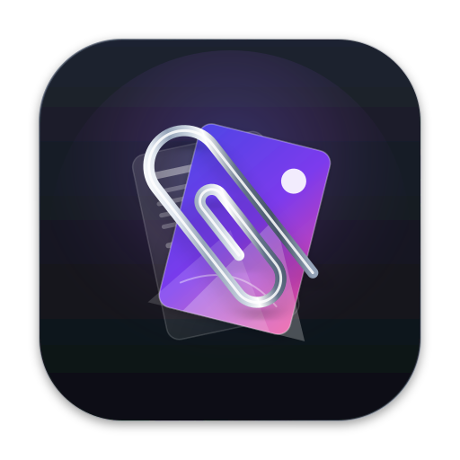

<p align="center">
  
</p>

<h1 align="center">CopyAttach</h1>

<p align="center">
  <strong>做全网最轻量高效的剪贴板管理软件。</strong>
</p>

<p align="center">
  
  
  
  
  
</p>

---

CopyAttach 是一个 macOS 剪贴板管理器。它默默记录你复制的一切——文本、代码、链接、图片——然后通过一个快捷键让你在任何应用中快速搜索、预览、粘贴。从渲染帧率到磁盘写入，从内存分配到功耗管理，每个环节都经过精心优化，做到真正的无负担。

## 一分钟上手

```bash
# 构建
./build.sh

# 启动
open "CopyAttach.app"

# 按 ⌥X 唤出历史记录
# ↑↓ 选择 → ⏎ 粘贴
```

就是这么简单。不需要配置，不需要注册，不需要联网。

## 为什么你需要它

macOS 自带的剪贴板只存一个条目。复制新内容，旧的就被覆盖了。

CopyAttach 替你保留了完整的剪贴板历史：

- **复制了重要内容却不小心又复制了别的？** 翻回去就能找到
- **想粘贴半小时前看到的那段代码？** 它还在
- **想同时引用几张截图？** 翻历史就行，不用反复切窗口

## 使用方式

| 操作 | 效果 |
|---|---|
| **⌥X** | 唤出 / 隐藏历史弹窗 |
| **↑  /  ↓** | 选择上 / 下一条 |
| **⏎** | 粘贴选中条目 |
| **␣** 空格 | 预览完整内容 |
| **⎋**  Esc | 关闭弹窗 / 预览 |
| **点击条目** | 直接粘贴 |

你可以自己在设置里改成顺手的快捷键。

## 核心设计原则

1. **不搞兜底**——主流程失败就暴露错误，不静默降级。你不会粘贴到错误的内容。
2. **不重复捕获**——粘贴时不会把自己刚写回的内容又读进来，形成死循环。
3. **不丢数据**——每条历史实时写入 SQLite，重启还在。
4. **不阻塞 UI**——读历史走无锁快照，Swift 随时拿到完整数据。

## 无负担的设计

作为常驻菜单栏的工具，我们对每一毫秒、每一 KB 都斤斤计较：

| 维度 | 做法 | 效果 |
|---|---|---|
| **性能流畅** | 无锁快照 + 两阶段图片捕获 + CatmullRom 快速缩略图 | 列表滚动不掉帧，4K 截图不卡顿 |
| **内存克制** | 512KB SQLite page cache + 动态阈值裁剪 + 缩略图按需加载 | 常驻内存在几 MB 量级，从不膨胀 |
| **存储精简** | mmap 读写 + write-through 即时去重 + 自动淘汰 | 数据库始终控制在阈值内，零碎片增长 |
| **功耗节制** | changeCount 轻量检测 + 300ms 低频轮询 + 异步编码 | 安静时 CPU 占用近乎为零 |
| **交互高效** | ⌥X 一键唤出 + CJK 感知搜索 + 键盘直达粘贴 | 从唤起到粘贴，常在一秒内完成 |

## 架构概览

```
┌────────────────────────────────────────────┐
│            Swift 前端（macOS 原生）          │
│  ┌─────────┐ ┌─────────┐ ┌──────────────┐ │
│  │ 设置窗口  │ │ 历史弹窗 │ │  预览窗口     │ │
│  │ SwiftUI  │ │ NSPanel │ │  NSPanel     │ │
│  └────┬────┘ └────┬────┘ └──────┬───────┘ │
│       │           │             │          │
│  ┌────┴───────────┴─────────────┴────────┐ │
│  │     ClipboardBackend（Swift FFI）      │ │
│  │  轮询 → 快照 → 缓存 → 渲染             │ │
│  └────────────────┬───────────────────────┘ │
└───────────────────┼─────────────────────────┘
                    │ C FFI（约 40 个导出函数）
┌───────────────────┼─────────────────────────┐
│        Rust 后端（cdylib）                   │
│                                            │
│  ┌──────────────┐  ┌─────────────────────┐ │
│  │  剪贴板监控    │  │  历史管理           │ │
│  │  300ms 轮询   │  │  去重 · 上限 3000   │ │
│  │  changeCount  │  │  Arc<Mutex<Vec>>   │ │
│  └──────────────┘  └─────────────────────┘ │
│  ┌──────────────┐  ┌─────────────────────┐ │
│  │  图片处理     │  │  SQLite 持久化      │ │
│  │  PNG 编解码   │  │  write-through     │ │
│  │  Lanczos3     │  │  mmap 读取         │ │
│  │  缩略图/哈希   │  │  512KB page cache │ │
│  └──────────────┘  └─────────────────────┘ │
│  ┌──────────────────────────────────────┐  │
│  │  Cmd+V 模拟（CGEventPost）            │  │
│  └──────────────────────────────────────┘  │
└────────────────────────────────────────────┘
```

### 数据流

```
你复制 → Rust 监控线程捕获 → 写入 SQLite + 内存历史
                                        ↓
                            Swift 发现变化 → 读取快照 → 渲染列表
                                        ↓
                            你选了一条 → Rust 写回剪贴板 → 模拟 Cmd+V
                                        ↓
                            监控线程跳过自己写入的内容（不重复捕获）
```

### 快捷键系统

两种机制确保在任何场景下都能唤出弹窗：
- **Carbon RegisterEventHotKey** — 系统级注册，应用在后台也生效
- **NSEvent global monitor** — 后备方案，覆盖 Carbon 的边缘情况

两者都需要 macOS「辅助功能权限」。首次运行时应用会自动引导授权。

## 项目结构

```
├── src/                       # Rust 后端（cdylib → libcopy_attach.dylib）
│   ├── lib.rs                 # 模块声明 + allow(dead_code)
│   ├── ffi.rs                 # 所有 extern "C" 导出函数、Snapshot API、存储管理
│   ├── backend.rs             # OnceLock 单例、entry_id 生成、常量、ignore rules
│   ├── monitor.rs             # 后台线程 300ms 轮询 arboard，ignore rules 过滤
│   ├── db.rs                  # SQLite write-through（mmap + page cache）
│   ├── history.rs             # 去重 + 头部插入，纯函数式
│   ├── ignore.rs              # 捕获时忽略规则（按 App/类型/文本长度过滤）
│   ├── image.rs               # PNG 编解码、Lanczos3 缩略图、内容哈希
│   ├── macos.rs               # changeCount 检测、CGEventPost Cmd+V / Ctrl+V
│   ├── types.rs               # ClipboardEntry 枚举、SourceApp 元数据
│   ├── tests.rs               # cfg-gated 单元测试
│   ├── stress.rs              # 应力测试数据生成（feature-gated）
│   └── bin/
│       └── stress_gen.rs      # 应力测试 CLI（需 stress-test feature）
├── SwiftApp/                  # Swift 前端（菜单栏应用）
│   ├── CopyAttachApp.swift        # @main, MenuBarExtra
│   ├── ClipboardBackend.swift     # Rust FFI 封装 + ObservableObject
│   ├── HotkeyManager.swift        # Carbon + NSEvent 双注册，录制模式
│   ├── ColorTheme.swift           # 深色/浅色 AppTheme
│   ├── CopyAttach-Bridging-Header.h  # C FFI 声明
│   ├── Info.plist
│   ├── App/
│   │   └── AppDelegate.swift      # 生命周期 + 弹窗/设置窗口管理
│   ├── Settings/
│   │   └── InlineSettingsView.swift  # 5 标签页设置面板
│   ├── Popup/
│   │   ├── HistoryPopupContent.swift  # 搜索/列表/预览/Undo
│   │   ├── HistoryPopupWindow.swift   # NSPanel 浮动弹窗
│   │   ├── PopupHostingView.swift     # 键盘事件拦截
│   │   ├── ItemRowView.swift          # 条目行渲染
│   │   ├── DateSeparatorView.swift    # 按日历日分组分隔符
│   │   └── LargeTextView.swift        # NSTextView 大文本
│   ├── Preview/
│   │   ├── PreviewWindow.swift        # 非 key 预览 NSPanel
│   │   ├── PreviewContent.swift       # 预览内容
│   │   ├── PreviewTextLayout.swift    # 文本度量
│   │   └── ZoomableImageView.swift    # 捏合缩放/平移/双击重置
│   ├── Backend/
│   │   ├── ClipboardItem.swift        # 条目枚举
│   │   └── AppIcon+Ext.swift          # 图标缓存
│   ├── Hotkey/
│   │   └── HotkeyConfig.swift         # Codable 配置
│   ├── Stress/
│   │   ├── StressTestPanel.swift      # 应力测试面板
│   │   └── StressTestViewModel.swift  # 应力测试 ViewModel
│   ├── SyntaxHighlight/               # 语法高亮（预留）
│   └── Utility/
│       ├── DebugLog.swift             # 调试日志
│       └── VisualWidth.swift          # CJK 视觉宽度
├── assets/
│   ├── icon.svg                 # 应用图标源文件
│   ├── icon_inner.svg           # 内嵌白底版本
│   └── about/                   # SVG 资源
├── build.sh                     # 构建脚本
├── Cargo.toml                   # Rust crate 配置
├── CLAUDE.md                    # 开发者指南
└── README.md                    # 本文件
```

## 构建依赖

- macOS 14.0+（Sonoma）
- Xcode 16+
- Rust 1.75+

## 调试

```bash
tail -f /tmp/copyattach_debug.log
```

## 许可证

MIT
